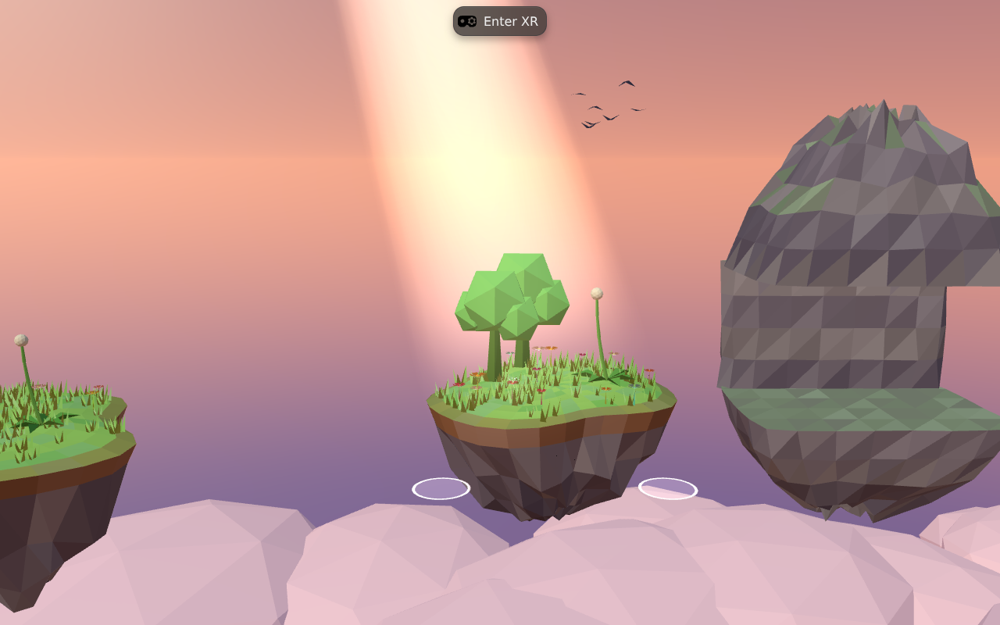
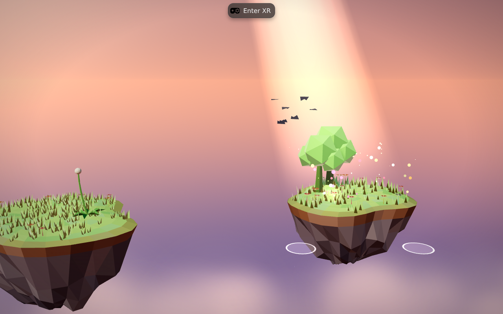
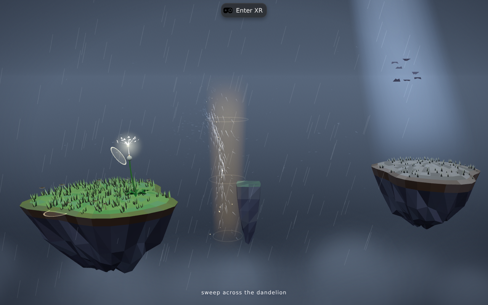

# The look: making GUST read as a place, not a render

Written 2026-11-12, after the first lighting and atmosphere pass. Screenshots in
`docs/images/` are real frames from the build in this repository, captured
headlessly at 1280×800, not mock-ups.

---

## The complaint, taken seriously

The build looked "generated": flat, evenly lit, pastel, no shadows anywhere,
a hard banded sky, a foreground of solid white icosahedra that read as snow.
None of that is a content problem — the diorama, the wind, the four acts were
already there. It was a **lighting and air** problem, which is the same problem
that separates a student low-poly scene from *Moss*.

## The references, and the specific thing borrowed from each

| Reference | What it actually does | What changed here |
| --- | --- | --- |
| **Moss** (Polyarc) | Every object is anchored by a visible shadow and a warm key; the diorama is lit like a miniature on a table, not like an open world. | One directional sun with a real 1024 px shadow map, frustum bound to the diorama (`configureSunShadows`). Flat-shaded scenery now casts and receives. |
| **Astro Bot: Rescue Mission** | Materials stay readable at arm's length because the key-to-fill ratio is high and the silhouette is always slightly brighter than the background. | Key light raised, hemisphere fill rebuilt per sky palette, and a fresnel rim on every opaque surface (`addRimLight`). |
| **Red Matter 2** | The "expensive" look is mostly highlight roll-off: nothing clips to paper white. | ACES filmic tone mapping at 1.18 exposure, replacing `NoToneMapping`. |
| **Tetris Effect** | Atmosphere is a substance you look *through* — layered haze, never a flat backdrop. | The cloud sea was rebuilt from solid icosahedra to a point-sprite mist: soft alpha puffs, per-point size and drift, fog-tinted by distance. One draw call. |
| **Walkabout Mini Golf** | Distance readability: far objects desaturate into the fog instead of competing. | Fog colour now drives both the sky blend and the cloud mist, and rain fades with fog instead of glowing through it. |
| **Half-Life: Alyx / The Room VR** | Nothing non-diegetic is ever allowed over play. | The wordmark used to float over live gameplay when starting mid-course; it now leaves the frame the moment a run is in progress. The lens vignette exists only on a flat screen and switches off when a session starts. |
| **Demeo** | Tabletop framing: the whole board is legible from a seated pose, nothing important is cropped at the edge of vision. | Camera pulled back, FOV narrowed 70°→66°, looking further down at the diorama. |
| **Beat Saber** | The eye needs one unmistakable focal point. | The seed remains the brightest thing in frame; the sun's disc and halo were strengthened so it reads as a light source rather than a painted circle. |

## Before / after

| Before | After (dawn) |
| --- | --- |
|  |  |

| After (storm) |
| --- |
|  |

## What changed, file by file

| File | Change |
| --- | --- |
| `src/render/look.ts` **(new)** | One place for the whole look: tone mapping + exposure, shadow map setup, the scene-wide pass that gives opaque surfaces shadows and a rim, and the quality switch that turns shadows off at `?quality=0.5`. |
| `src/render/sky.ts` | Sun disc/halo strengthened; fBm-free dithering to kill 8-bit banding; dome tessellation raised 32×16 → 64×40 (the old facets showed as a seam across the sky); storm palette re-filled so islands are readable instead of silhouetted. |
| `src/render/extras.ts` | `CloudSea` rewritten as a single `Points` cloud with a procedural puff shader; thermal columns and their rings quietened so they suggest air instead of a tan cylinder. |
| `src/render/air.ts` | Rain: opacity 0.20–0.60 → 0.10–0.30, cooler tint, fog enabled — it was reading as television static against a dark sky. |
| `src/systems/gust.ts` | Renderer configured before first compile; scene dressed once after assembly; wordmark fix; flat-screen vignette. |
| `iwsdk.config.json` | Camera reframed for the diorama. |

Verified after the pass: `tsc --noEmit` clean, **124/124 tests pass**, production
build succeeds.

## How the screenshots were made

There is no browser in this sandbox and the Playwright CDN is unreachable, so
the frames were captured with a Chromium binary that ships *inside* an npm
package (`@sparticuz/chromium`), launched through `playwright-core`, with
SwiftShader for WebGL 2. It renders the real dev server — the same code a Quest
runs. That loop (edit → capture → look) is how each tuning decision above was
checked rather than guessed.

## What this pass does **not** fix

Being blunt, because "looks amazing" is easy to claim and hard to earn:

1. **Animation is the next ceiling.** Nothing here added secondary motion
   quality — grass and petals bend, but there is no anticipation, no
   squash-and-stretch on the seed, no weight. *Astro Bot* and *Moss* live on
   this, and it is worth more than another lighting tweak.
2. **Material variety is still one flat palette.** Every surface is the same
   Lambert response. Moss differentiates stone, moss, cloth and water by
   roughness and edge wear, not by hue.
3. **Audio is the most under-used realism channel.** *Tetris Effect* earns its
   "real" feeling largely through sound following the world. GUST's score is
   procedural but not yet spatially reactive to the wind field the way the
   visuals are.
4. **Hand presence is unproven.** No screenshot can show whether hands feel
   *yours*. That needs a headset, and it is the single biggest presence lever
   left.
5. **Performance is unmeasured.** A 1024 px shadow map plus a rim term is not
   free on Quest 3 at 72 Hz. `?quality=0.5` disables shadows, but the real
   number needs a device profiler.
6. **One authored glance is missing.** Every top VR product has a signature
   beat in the first thirty seconds. GUST's is the seed lifting on your sweep —
   it deserves bespoke animation, sound and light rather than the general
   particle burst it gets.

## Next, in priority order

1. Seed feel: anticipation, drag, squash on landing, a shadow that tracks it.
2. Hand presence: soft contact shadow of the palm on the diorama, and a haptic
   tick the moment a gesture is recognised.
3. Audio: wind-driven filters so the score breathes with the same field the
   grass does.
4. Device pass: shadows on/off at 72 Hz, then decide the budget.
5. Material pass: three roughness behaviours (foliage, stone, water) instead of
   one.

---

# Second pass: feel

The first pass taught the scene to *look* lit. This one teaches it to *move* and
to *touch*. Same rule as before: nothing was claimed until it was observed in a
running build.

## What changed

| Change | Why | Reference |
| --- | --- | --- |
| **Seed squash & stretch** (`src/render/seeds.ts`) | Released seeds squash for 160 ms, then stretch along their own axis in proportion to speed, with volume preserved (`x = 1/√y`). Derived from the interpolated position history, so the simulation is untouched and the core stays pure. | *Astro Bot*: every object deforms with its velocity. |
| **Seed ground shadow** | A soft blob projected onto whatever is under the seed via the existing `groundBelow` query, fading with height. It answers "how high am I?" — the question a player asks most in a game about carrying something. | *Half-Life: Alyx*'s object shadows; *Moss*'s positional clarity. |
| **Palm contact shadow** (`PalmShadow`) | Hands darken the island under them. Height is converted from simulation units to **world metres** before deciding strength, because the world is 1:7 and a naive threshold made the shadow invisible. | Every tabletop game since *Demeo*; real hands in a real room cast one. |
| **Haptic gesture ticks** (`XRHands.pulse`) | A 16 ms pulse the moment a gesture is recognised — both hands for clap/updraft/whirl, one hand for a sweep, scaled by strength. Tracked hands have no actuator, so it degrades to a no-op instead of throwing. | *Beat Saber*'s hit confirmation; *Pistol Whip*'s beat ticks. |
| **Soft blob texture** (`src/render/blob.ts`) | A shadow is a gradient, not a black disc. Generated as a `DataTexture` — no canvas, no asset file, works headless. | — |

## What was measured, not assumed

- `tsc --noEmit` clean; **124/124 tests pass**; production build succeeds.
- Seed shadow instancing, sampled live during a scripted ghost run:
  `shadowCount` is **0** over open sky and **1** the moment the seed crosses an
  island (t≈3.9 s), staying 1 after planting. The blob is genuinely
  ground-projected, not drawn unconditionally.
- Palm shadow rendering was verified by forcing a placement on an island — it
  draws as a soft dark pool. It could **not** be verified from a real hand here:
  the desktop pointer hand sits *below* the island surface (`y = −0.28`), so
  `groundBelow` correctly finds nothing. That path needs a headset.
- Haptics cannot be verified without hardware. The code path is guarded and
  falls back silently.

## Two things learned the hard way

1. **Multiply blending is a trap.** With `MultiplyBlending`, strength lives in
   the *colour*, alpha only premultiplies, and without `premultipliedAlpha` the
   driver renders a bright square instead of a shadow. Ordinary alpha blending
   with a radial `DataTexture` behaves the same everywhere. The blob module now
   does the latter.
2. **Units are a design constraint, not a detail.** The first shadow threshold
   was written in simulation units; because the world is 1:7, a hand 20 cm above
   the table is 1.4 units, and the shadow never appeared. Every user-facing
   distance in the renderer now converts to world metres first.

## Still unmeasured

Frame cost. The shadow map now has grass, foliage, stone and islands in it, and
the rim term runs on every opaque fragment. On a desktop GPU that is nothing;
on a Quest 3 at 72 Hz it is a real question, and `?quality=0.5` (shadows off) is
the fallback until someone profiles it on device.

---

# Third pass: sound

The score was already synthesised; what it was not was *driven*. The wind made
the grass move and the rain fall, and the music ran beside it on its own terms.
This pass wires the synthesiser to the same field, so a gust you can see is a
gust you can hear.

## What changed

| Change | Why |
| --- | --- |
| `src/audio/mix.ts` **(new)** | Every wind-to-sound mapping in one pure module: air cutoff, hand cutoff, chord openness, gust swell, stereo pan, ducking. No Web Audio, so it is unit-testable. |
| **The chord breathes** | The three pads now run through one shared lowpass whose cutoff follows wind and turbulence — calm air keeps the harmony closed and warm, a blow opens it. A gust opens it further for a moment, then it settles. |
| **Stereo from the field** | The world's air bed is panned by the prevailing wind direction; the pads lean *against* it, so the mix does not all move together. Below a walking-pace breeze the direction centres, because noise has no direction. |
| **Ducking** | The world bed drops up to 45% while the player is making wind, so their own gesture is always the loudest thing. |
| **`AnalyserNode` on the master** | `spectrum()`, `centroid()` and `level()` exist so the mix can be *measured* instead of admired. |

## Measured

The audio update was isolated from the game loop and driven with known frames,
then the actual `AudioParam`s and the live spectrum were read back:

| Frame | Chord cutoff | World pan | Pad pan | World gain | Spectral centroid |
| --- | --- | --- | --- | --- | --- |
| calm | 420 Hz | 0.000 | 0.000 | 0.051 | 358 Hz |
| wind +3, turb. 1.2 | 2120 Hz | **+0.500** | −0.203 | 0.246 | 755 Hz |
| wind −3, turb. 1.2 | 2120 Hz | **−0.457** | +0.168 | 0.256 | 798 Hz |
| hand wind 8 + wind +3 | 1920 Hz | +0.461 | −0.174 | **0.146** | 2913 Hz |

And through the real game loop, a gust in flight:

| | centroid | chord cutoff | swell |
| --- | --- | --- | --- |
| before | 302 Hz | 658 Hz | 0.00 |
| 160 ms after a gust | **1362 Hz** | **700 Hz** | 0.40 |
| 2.6 s later | 948 Hz | 659 Hz | 0.00 |

So: the chord opens with wind and closes again, the bed leans the way the wind
blows and flips when it reverses, the chord counters it, and the player's own
wind pushes the world bed down. `tsc` clean, **132/132 tests pass** (8 new mix
tests), build succeeds.

## What still cannot be checked here

- **Timbre.** These are measurements, not listening. Whether the pad opening
  from 420 to 2120 Hz sounds *good* rather than *harsh* needs ears, and I have
  none in this environment. The cutoff ceiling and Q are the two knobs to
  revisit first.
- **Headset audio.** Quest does its own spatialisation; `StereoPannerNode` is
  the flat-screen approximation. In a session this wants `PannerNode` with HRTF,
  positioned at the wind's origin.
- **Levels against the real mix.** The compressor thresholds were tuned before
  the chord moved; the pad may now sit too hot during a storm.
