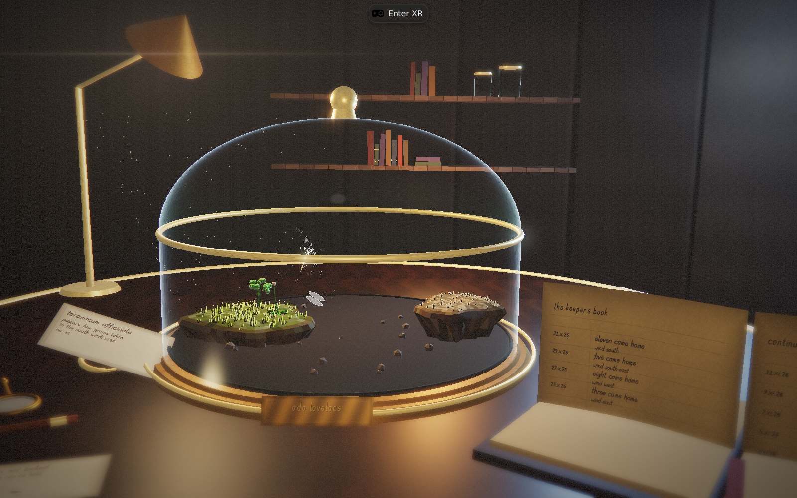

# The Wind Cabinet — direction and first slice

Committed 2026-11-12. Direction chosen by the owner: **B, The Wind Cabinet**, to
be built as a competition showpiece.

---

## Why the previous version failed

Not lighting. It failed because:

1. **The art direction was a default.** Pastel low-poly floating islands are the
   most common look in VR demo footage. Nothing in it was a choice.
2. **Nothing carried a human trace.** No wear, no handwriting, no object anyone
   would have owned.
3. **It had no reason to exist.** A wind toy is a tech demo.

More lighting on a stock composition makes a stock composition look expensive.
It does not give it a soul.

## The direction

**A naturalist's specimen table, at night, one lamp on.** The floating islands do
not change — what changes is that they are no longer a landscape. They are an
object on a desk, inside brass and glass, being studied.

References, and the specific thing borrowed:

| Reference | Borrowed |
| --- | --- |
| Victorian naturalist's specimen tables; the Harvard glass flowers | The intimacy and the premise: this is a thing someone made, keeps and labels. |
| *The Room VR* | Material honesty at arm's length — brass reads as brass because it is worn. |
| *Red Matter 2* | One source of light, and everything else earned by it. |
| *Moss* | Scale as affection: a small world you lean over. |
| *Demeo* | Framing a tabletop so the whole board is legible from a seated pose. |

Target frame: `docs/concepts/direction-b-cabinet.png`.
First in-engine frame: `docs/images/cabinet-first-slice.png`.

## What is actually in this slice

| Change | Detail |
| --- | --- |
| **`src/render/room.ts`** (new) | Desks, bell jar, lamp, dust and the room behind it. All procedural: walnut and brass are generated `DataTexture`s, so there are still no asset files. |
| **The world is now 1:18, not 1:7** | The single most important fix. At 1:7 the course was a metre wide — a playset — and the "specimen" was a 1.6 m vitrine with its rim cutting across the player's view. At 1:18 it is ~39 cm across: something you lean over. |
| **Gesture feel preserved** | `UNIT` is both the render scale and the gesture `unitScale`, so shrinking the world keeps a sweep feeling like a sweep. Only the size of the world it moves changed. |
| **The lamp is the light** | The old sky sun stops casting; a spot inside a brass shade does the work, with a warm bulb, a soft beam cone and a dim wall wash. The three "skies" became three qualities of lamplight. |
| **Palette muted** | Grass, earth and rock moved from pastel to olive, umber and ash — specimens under a warm lamp, not a mobile game. |
| **Indoors is indoors** | The cloud sea and the gulls are gone; dust in the beam replaced them. |
| **Case centred on the course** | The room sits over the *middle of the course* (`root.localToWorld(viewX)`), not over island zero — which is why the world used to spill out of the jar. |

Verified: `tsc` clean, **132/132 tests pass**, production build succeeds, and the
frame above is the running build, not a mock-up.

## What is missing, and what I would do next

This is a **first slice**, and it is not yet the concept. In priority order:

1. **The human trace.** Pinned specimen cards with handwritten labels; a brass
   plaque that takes the player's name; a drawer that keeps every seed ever
   planted, with the date. This is the soul the frame still lacks — right now
   the room is empty of people.
2. **Interaction with the furniture.** The magnifier should be pickable; the
   lens should actually magnify the specimen. That is the *toy* a museum case
   wants, and it is one shader.
3. **The cabinet as UI.** No floating panels: the act select is a drawer, the
   options are brass switches. Diegetic or nothing.
4. **Lamp craft.** The shade silhouette is currently crude and the arm reads as
   a stick. A lathed profile would fix it in an afternoon.
5. **Performance.** MeshStandardMaterial + spot shadows is a heavier stack than
   the old flat-shaded build; this needs on-device measurement before anyone
   claims it runs at 72 Hz.

---

# Pass two — the human trace

The first slice was a room with nobody in it. This pass puts a person on the
desk: their book, their labels, their name in the brass. Frame:
`docs/images/cabinet-paperwork.png` (the running build, 1280×800).

## What went in

| Change | Why it exists |
| --- | --- |
| **`src/render/ink.ts`** (new) | A software ink-and-paper rasteriser: laid papers, foxing, deckled edges, and a round nib that lays ink with `max` so a crossed stroke keeps one wet edge. No canvas, no fonts, no asset files — it runs in Node, so it is testable. |
| **`src/render/pen.ts`** (new) | A single-stroke hand: 26 letters, 10 digits and punctuation as polylines in an em box, drawn with pressure that varies along the stroke, a lifted nib that leaves a dot, and a baseline that never quite settles. Capitals are small caps of the same hand — engraver's script. Same seed, same page. |
| **`src/core/journal.ts`** (new) | The keeper's book as plain data: day, seeds home, wind bearing, how alive the air was. Parsed defensively, capped at 22 entries, newest first. The ledger on the desk *is* this data. |
| **`src/render/marks.ts`** (new) | The paperwork: an open ledger with ruled pages, a spine, a ribbon and a pencil across the corner; three slips (a herbarium label, and two notes from the maker); a brass plaque with the keeper's name cut into it; a loupe; five loose achenes; the dried ring of a cup. |
| **The book comes written in** | A new player finds nine entries in a previous keeper's hand, dated a fortnight back. Their own runs go in underneath. A save file is not an object with a history; a ledger is. |
| **Every completed run is a line** | `runComplete` writes `12.xi.26 — nine came home / wind south-west` to the book, saves it to `localStorage['gust.journal.v1']`, and redraws the page. The newest line is written wetter, with a blot at the stop. |
| **The name in the brass** | `?keeper=ADA LOVELACE` cuts the name into the plaque; without it the plate reads `KEEPER OF SMALL WEATHERS`. Sanitised to letters, spaces, `.`, `'`, `-`, 26 characters. |

## What else changed to make the room hold up

- **The world is 1:30, not 1:18.** At 1:18 the course was 39 cm and the bell jar
  had to be wider than the desk. At 1:30 it is 23 cm — a specimen you lean over,
  inside a 35 cm jar on a 1 m desk.
- **A bell jar, not a hoop.** Wall, domed top, brass collar, knob; and a fresnel
  shader on the glass (`opacity 0.03` face-on, bright rim at the silhouette), so
  it reads as glass instead of a grey film.
- **Reflections.** Brass is nothing but its reflection, and a room has no HDR sky
  to borrow: the room renders itself into a 128 px cube once at startup and the
  metal and glass use that. Six renders, once, no per-frame cost.
- **The desk is rectangular where it is used.** The concentric leather disc was
  the thing that made the scene look like a lazy susan; it is now a square
  blotter under the book, and the jar stands on bare walnut with a contact
  shadow under it.
- **Contact shadows** under the jar, book, slips and loupe. The bulb's halo is a
  radial-gradient sprite now, not a translucent sphere.
- **No sunbeam indoors.** The shaft of light through the room was the outdoor
  sunbeam system; the lamp is the only light that comes from anywhere.
- **Camera**: a chair at the desk — eye a hand's width above the table, 0.66 m
  from the glass, the ledger falling out of frame at the right. The seed's height
  no longer drags the desk up and down (0.42 → 0.12 gain).

## Verified, and how

- `tsc --noEmit` clean; **156/156 tests**; `GUST_HTTP=1 vite build` succeeds.
- New tests: `tests/pen.test.ts` (10) — ink is laid where the nib goes, ink does
  not double on crossing, the hand is deterministic per seed, small caps stand
  taller than x-height, every letter has a glyph. `tests/journal.test.ts` (14) —
  dates, roman months, wind words, clamping, storage round-trip, and that
  nonsense in storage yields an empty book rather than an error.
- **The ledger really updates.** `/home/user/.browser/ledgerprobe.mjs` loads the
  build, injects the `runComplete` event the game itself emits, and reads the
  result back: `9 → 10` entries, newest `{ day: 20769, seeds: 7, bearing: 126,
  course: "First Breath" }`, and `localStorage['gust.journal.v1']` contains it.
  The same frame shows the new line at the top of the page.
- **The plaque really takes a name**: the frame above was captured with
  `?keeper=ADA LOVELACE`.

## Pass three: the lens

Pass two was rejected, and correctly. The room was built; the *picture* was not.
A frame made by a renderer and a frame made by a camera differ in ways that have
nothing to do with the model in the middle.

**`src/render/post.ts`** — a hand-written chain, no composer, no addons:

| stage | what it does |
| --- | --- |
| scene target | half float, linear, tone mapping *off* (three disables it for render targets), so the film curve happens exactly once |
| defocus | half-res blur mixed back through a **tilt-shift band** |
| halation | quarter-res bright pass, separable blur, added back |
| composite | defocus · bloom · ACES · colour-negative grade · fringing · vignette · grain · sRGB |
| flare | veiling glare, an aperture streak and four ghosts, anchored to the bulb's projected position |

The depth-of-field is a tilt-shift, not a depth solve, and that is a deliberate
choice rather than a shortcut: the subject is a specimen on a desk photographed
from a chair, which is precisely the thing a tilt-shift lens exists for. It is
also stable, because the camera is.

**`src/render/glass.ts`** — the bell jar is no longer a `MeshStandardMaterial`
with a fresnel patched into it, which at this distance is a milk jug. It is
additive and hand-authored: an edge that only exists at the silhouette, *two*
highlights a fraction of a degree apart (near face and far face, which is why a
real jar's highlight looks doubled), green where the glass is thick at the foot,
and a procedural smudge so the rim is not a mathematical gradient.

**The near field.** The bottom third of the frame used to be empty varnished
wood, and empty foreground is the loudest tell that a frame was built rather
than taken. There is now a pencil laid down mid-sentence, five index cards
squared up by hand and not quite square, a dried coffee ring, a hand lens, and
grit in the bottom of the case.

**Light.** Ambient dropped to a trace (hemi 0.085, sun 0.035) and every mesh in
the room now casts into the lamp's shadow map. Nothing was throwing anything
onto the desk before, which is why the desk read as a flat brown field. A cold
window on the right splits the palette so the frame is not one orange.

**The tree.** It was a trunk with three icosahedra on it — the most recognisable
procedural silhouette there is. It is now built the way a tree is built: a trunk
that forks, forks again, leaves only at the ends, every fork at its own angle
and with its own share of the parent's length. (The first attempt came out as a
vertical stack of clumps because the recursion shared its scratch vectors, which
is exactly the kind of thing that only shows up when you look at the picture.)

## Pass three, continued

- **The islands have ground.** Patches, not noise: moss in the folds, scoured
  bare on the shoulders, lichen on the windward cliff, boulders half-buried at
  the coast where the crust is thin. The undersides carry beds of rock instead
  of a gradient — colour only, because cutting extra ledges into the silhouette
  made the island read as a decorated cake.
- **The case is lit from inside.** Glass scatters a little of the light that
  falls on it, and that scatter is the only thing lighting the middle of a
  specimen case. A point light held strictly inside the jar stands in for it, so
  it can never reach the desk and flatten the lamp's shadow.
- **The window is off-frame, and stays there.** I built one, twice, and could
  not get it into the picture: the room is a metre and a bit across and the
  camera is aimed at the desk, so the only wall in frame is the one behind the
  shelves. What is visible instead is the *falloff* — a cold wash down the
  panelling on the right and the raw edge it cuts on the ledger. That is how
  off-camera light actually behaves, so the effect survived and the window did
  not.

## The silhouette, and the weather

Two things were still wrong with the specimen itself.

**The coastline was smooth at every scale.** `islandRim` had three harmonics and
`SEGS` was 30, so the coast was a curve — which is exactly what makes a
generated shape read as generated. It now carries five harmonics (two of them
short and small, at the scale of a stride rather than a bay) and is meshed at 46
segments. More importantly, **the height of the coast now varies around the
island**: the rim used to sit at one height at every angle, which is why the
skyline was a flat line seen from the side. Headlands and bays, weighted by
c⁴ so the middle of the island is untouched.

**The island was a coin.** The crust now overhangs the rock it is made of — the
cliff band flares out below the turf and the underside pulls in beneath it.
That, more than any amount of noise on the coastline, is what stops it reading
as a pancake with a shadow under it.

And one bug that had been sitting there: **rain was falling indoors**, across
the study, through the glass. Weather in this game belongs to the specimens, not
to the room they stand in, so the room gets none. Obstacle boxes in mid-air were
also keeping their six flat faces and reading as green cubes in the case; every
box is chiselled now, and only the face the seed flies past stays true to the
collision box.

## What pass three still does not have

- The islands are still pancakes. Now that there is a lens on them, that is the
  next thing the eye lands on.
- Nothing is measured on a headset. The post chain is browser-only by design; in
  XR the renderer draws straight to the framebuffer, which is the correct
  behaviour and also means the headset sees a plainer frame than this one.

## Still wrong — the honest list

1. **The glass does not refract.** It has an edge, two highlights and a green
   foot, and it reads as glass — but nothing behind it bends. A real refraction
   needs a transmission pass or a screen-space sample; on Quest it needs
   measuring first.
2. **The islands are still pancakes.** The underside now carries beds instead of
   a gradient, but the skyline is still flat and there are no scale cues beyond
   grass. They are the specimen and they are the weakest geometry in the frame:
   they need a rebuilt coastline with an overhang and a ragged edge.
3. **The room behind the desk is still mostly a void.** The panelling helped;
   the shelves still float, and there is no window to tell you where the cold
   light on the right is coming from.
4. ~~No depth of field.~~ Done in pass three, as a tilt-shift band. It is stable
   because the camera is; if the camera ever moves, this needs a real depth
   solve and the n/56-detail of that is written up in `src/render/post.ts`.
5. **Nothing is pickable.** The loupe lies there. Picking it up and having the
   lens magnify is the next interaction, and the paperwork is what it magnifies.
6. **On-device frame cost is unmeasured.** Spot shadows, a fresnel shader, a cube
   map and four lights have never run on a headset. Do not quote a frame rate.

## Flags added

| Flag | Effect |
| --- | --- |
| `?keeper=NAME` | Cuts that name into the brass plaque. |
| `?reset=1` | Clears the garden **and** the book. |
| `npx vite-node scripts/pen-preview.ts` | Writes `pen-alphabet`, `pen-card`, `pen-ledger` PNGs to `/home/user/shots` so the hand can be looked at. |
